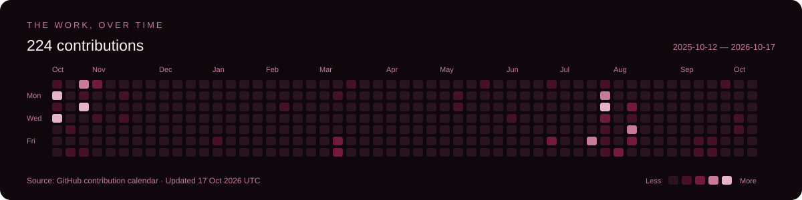

  

  <a href="https://nitesh0007-edith.github.io"><b>Portfolio</b></a> &nbsp; / &nbsp;
  <a href="https://www.linkedin.com/in/nitesh0007/">LinkedIn</a> &nbsp; / &nbsp;
  <a href="mailto:niteshranjansingh85389@gmail.com">Email</a> &nbsp; / &nbsp;
  <a href="https://topmate.io/nitesh2039">Book a 1:1</a>

## 01 / A little about me

I’m **Nitesh Ranjan Singh**, a Data Engineer and AI Engineer based in **Glasgow, Scotland**. I build reliable data platforms and AI systems that turn complex information into something useful.

My background spans **3+ years at IQVIA and Axtria**, working on pharmaceutical analytics for **GSK, J&J, and AstraZeneca**. My education is an **MSc in Data Science at the University of Glasgow (2025–2026)** with a **£10,000 Excellence Scholarship**.

> I like the hard, unglamorous middle of the stack — pipelines that don’t break silently at 2am. Fuelled by strong chai.

- **Work:** Data System & CRM Migration Intern at **Street Connect**, Glasgow, since June 2026.
- **Research:** MSc dissertation on explainable and fair recommender systems, with ACM RecSys 2026 as a research direction.
- **Currently exploring:** QLoRA / DPO fine-tuning, vLLM serving, hybrid RAG, and MCP tool-use agents with production guardrails.
- **Community:** Mentored **50+ students** on UK Master’s programmes and data careers, with a **5/5 rating** on [Topmate](https://topmate.io/nitesh2039).
- **Beyond this page:** My [portfolio reads like a manga](https://nitesh0007-edith.github.io) — issue #1 is out.

<b>Experience in focus</b>

- CDC and metadata-driven ETL handling **10M+ records per batch at 99.8% accuracy**.
- Omnichannel data-platform work supporting **GSK’s €2B+ European pharma portfolio**.
- QLoRA / DPO fine-tuning and **vLLM serving at &lt;200ms P95**.
- Hybrid retrieval using **BM25, dense retrieval, reciprocal rank fusion, and reranking**, with a cite-or-abstain approach.

## 02 / Recognition & credentials

| Recognition | Result |
| :--- | :--- |
| **LLM Agentic Legal Information Retrieval · Kaggle** | **2nd place**, Team HyperX · **$3,000** · [Legal citation retrieval](https://github.com/dharun-cohere/LLM_agentic) |
| **GUTS 2025 Hackathon · Morgan Stanley** | **Runner-up** · AURA, an MCP gateway for agentic network management |
| **CodeOlympic26 · Glasgow University Tech Society** | **Gold medal** · Competitive programming |
| **PyQVIA 2024 · IQVIA, London** | **3rd place** · Patient information outlier detection · **€300** |
| **Smart India Hackathon 2021 · UPES, India** | **Winner** · Smart attendance monitoring · **₹50,000** |

**Certifications** · Azure Data Engineer Associate **(DP-203)** · Fabric Data Engineer Associate **(DP-700)** · Databricks Data Engineer Associate · IBM Data Science Professional

## 03 / Selected work

### [LectureLens ↗](https://github.com/nitesh0007-edith/lecturelens)

A learning copilot that turns course material into **cited answers, quizzes, and exam practice**, using hybrid retrieval with £0 infrastructure.

`FastAPI` `BM25 + BGE` `Qdrant` `Groq`

### [HyperX · Legal Citation Retrieval ↗](https://github.com/dharun-cohere/LLM_agentic)

Agentic hybrid retrieval for **Swiss legal citations**. Built with Team HyperX; **2nd place** in Kaggle’s LLM Agentic Legal Information Retrieval competition.

`BM25` `E5` `FAISS` `RRF` `Reranking`

### [AutoPipelineAI ↗](https://github.com/nitesh0007-edith/AutoPipelineAI)

Turns natural-language requests into **executable data pipelines**, cutting analysis time by **70%**.

`Streamlit` `Databricks` `DuckDB` `Llama 3`

### [ECG Arrhythmia Detection ↗](https://github.com/nitesh0007-edith/ECG-Explainable-Machine-Learning)

Arrhythmia classification with **99.79% accuracy** and triple-validated explainability through **SHAP, LIME, and permutation feature importance**.

`PyTorch` `ResNet` `MIT-BIH` `Explainable ML`

### [Market Wars Simulator ↗](https://github.com/nitesh0007-edith/market-wars-simulator)

Investment-strategy backtesting with **Sharpe, Sortino, and drawdown metrics** to compare performance and risk.

`Python` `Streamlit`

## 04 / Tools I work with

| Area | Technologies |
| :--- | :--- |
| **Languages** | Python · SQL · PySpark · R |
| **Data & cloud** | Azure · AWS · Databricks · Delta Lake · Snowflake · PostgreSQL · DuckDB |
| **AI & retrieval** | PyTorch · Hugging Face · scikit-learn · QLoRA · DPO · vLLM · Qdrant · MCP |
| **Engineering & delivery** | Docker · Kubernetes · FastAPI · GitHub Actions |
| **Applications & analytics** | Streamlit · Next.js · Power BI |

## 05 / The work, over time

GitHub contribution data, rendered in burgundy. The image shows its reporting period and last refresh date. [Explore my repositories ↗](https://github.com/nitesh0007-edith?tab=repositories)

<b>A little motion · contribution snake</b>

An animated view of my GitHub contributions, refreshed by the existing snake workflow.

<picture>
  <source media="(prefers-color-scheme: dark)" srcset="https://raw.githubusercontent.com/nitesh0007-edith/nitesh0007-edith/output/github-contribution-grid-snake-dark.svg" />
  <source media="(prefers-color-scheme: light)" srcset="https://raw.githubusercontent.com/nitesh0007-edith/nitesh0007-edith/output/github-contribution-grid-snake.svg" />
  
</picture>

## 06 / Let’s connect

Open to **Data Engineer and AI Engineer opportunities** and conversations about reliable data systems, grounded AI, and explainable machine learning.

**[Say hello by email](mailto:niteshranjansingh85389@gmail.com)** · [Connect on LinkedIn](https://www.linkedin.com/in/nitesh0007/) · [Book a mentoring session](https://topmate.io/nitesh2039) · [Read my portfolio](https://nitesh0007-edith.github.io)

  

