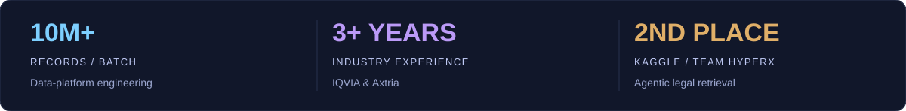
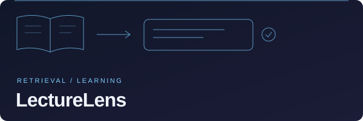
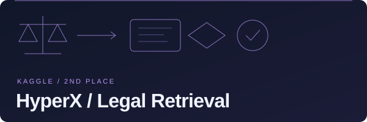
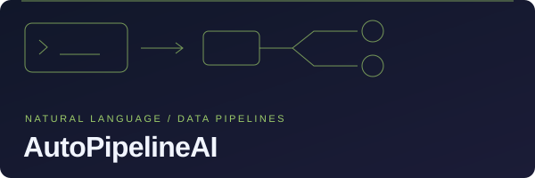
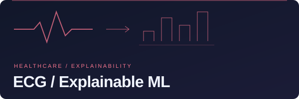

<picture>
  <source media="(max-width: 600px)" srcset="assets/hero-mobile.svg" />
  
</picture>

<p align="center">
  <b><a href="https://nitesh0007-edith.github.io">PORTFOLIO ↗</a></b> &nbsp; · &nbsp;
  <b><a href="https://www.linkedin.com/in/nitesh0007/">LINKEDIN ↗</a></b> &nbsp; · &nbsp;
  <b><a href="mailto:niteshranjansingh85389@gmail.com">EMAIL ↗</a></b> &nbsp; · &nbsp;
  <b><a href="https://topmate.io/nitesh2039">MENTORING ↗</a></b>
</p>

### Building the useful things between data and intelligence.

I’m **Nitesh**, a **Data Engineer & AI Engineer** in Glasgow. My work spans pharmaceutical data platforms at **IQVIA and Axtria**, hybrid retrieval, and production-minded AI systems. I like the hard, unglamorous middle of the stack — pipelines that don’t break silently at 2am. Fuelled by strong chai. ☕

<picture>
  <source media="(max-width: 600px)" srcset="assets/impact-mobile.svg" />
  
</picture>

## ⚡ Selected builds

<table>
<tr>
<td width="50%" valign="top">
<a href="https://github.com/nitesh0007-edith/lecturelens"></a>
<p><b><a href="https://github.com/nitesh0007-edith/lecturelens">LectureLens ↗</a></b></p>
<p>From course material to <b>cited answers, quizzes, and exam practice</b>. Hybrid RAG, with £0 infrastructure.</p>
<p><code>FastAPI</code> <code>BM25 + BGE</code> <code>Qdrant</code> <code>Groq</code></p>
</td>
<td width="50%" valign="top">
<a href="https://github.com/dharun-cohere/LLM_agentic"></a>
<p><b><a href="https://github.com/dharun-cohere/LLM_agentic">HyperX · Legal Retrieval ↗</a></b></p>
<p>Agentic hybrid retrieval for <b>Swiss legal citations</b>. Kaggle <b>2nd place</b> with Team HyperX; <b>$3,000</b> prize.</p>
<p><code>BM25</code> <code>E5</code> <code>FAISS</code> <code>RRF</code> <code>Reranking</code></p>
</td>
</tr>
<tr>
<td width="50%" valign="top">
<a href="https://github.com/nitesh0007-edith/AutoPipelineAI"></a>
<p><b><a href="https://github.com/nitesh0007-edith/AutoPipelineAI">AutoPipelineAI ↗</a></b></p>
<p>Natural language → <b>executable data pipelines</b>. Built to cut analysis time by <b>70%</b>.</p>
<p><code>Streamlit</code> <code>Databricks</code> <code>DuckDB</code> <code>Llama 3</code></p>
</td>
<td width="50%" valign="top">
<a href="https://github.com/nitesh0007-edith/ECG-Explainable-Machine-Learning"></a>
<p><b><a href="https://github.com/nitesh0007-edith/ECG-Explainable-Machine-Learning">ECG · Explainable ML ↗</a></b></p>
<p>Arrhythmia classification at <b>99.79% accuracy</b>, with explainability validated through <b>SHAP, LIME, and PFI</b>.</p>
<p><code>PyTorch</code> <code>ResNet</code> <code>MIT-BIH</code> <code>SHAP</code></p>
</td>
</tr>
</table>

**Also building:** [Market Wars Simulator ↗](https://github.com/nitesh0007-edith/market-wars-simulator) — investment-strategy backtesting with Sharpe, Sortino, and drawdown metrics. `Python` `Streamlit`

## 🧭 The current chapter

- **Work** → Data System & CRM Migration Intern at **Street Connect**, Glasgow *(June 2026–present)*.
- **Study** → **MSc Data Science, University of Glasgow (2025–2026)** · **£10K Excellence Scholar**.
- **Research** → Explainable and fair recommender systems for my MSc dissertation, with **ACM RecSys 2026** as a research direction.
- **Deepening the stack** → QLoRA / DPO fine-tuning, vLLM serving, hybrid RAG, and MCP tool-use agents with production guardrails.
- **Giving back** → Mentored **50+ students** on UK Master’s programmes and data careers · **5/5 rating** · [Book a 1:1 ↗](https://topmate.io/nitesh2039).

<details>
<summary><b>📖 Open the character sheet</b></summary>

```python
class DataAIEngineer:
    name = "Nitesh Ranjan Singh"
    location = "Glasgow, Scotland"
    background = "3+ years at IQVIA & Axtria"
    domains = ["GSK", "J&J", "AstraZeneca"]
    build_style = "Reliable data. Grounded AI. Strong chai."

    special_moves = {
        "pipeline_mastery": "CDC + metadata-driven ETL",
        "llm_forging": "QLoRA / DPO + vLLM",
        "hybrid_rag": "BM25 + dense + RRF + rerank",
        "agent_summoning": "MCP + production guardrails",
    }
```

**Experience in focus**

- **10M+ records per batch at 99.8% accuracy** with CDC and metadata-driven ETL.
- Omnichannel data-platform work behind **GSK’s €2B+ European pharma portfolio**.
- QLoRA / DPO fine-tuning and vLLM serving at **&lt;200ms P95**.
- A **cite-or-abstain** approach to retrieval and grounded answers.

</details>

## 🏆 Battle record

| Arena | Result | Build / recognition |
| :--- | :--- | :--- |
| **Kaggle · LLM Agentic Legal Information Retrieval** | 🥈 **2nd place** | Team HyperX · Swiss legal retrieval · **$3,000** |
| **Morgan Stanley · GUTS 2025** | 🥈 **Runner-up** | AURA · MCP gateway for agentic network management |
| **Glasgow University Tech Society · CodeOlympic26** | 🥇 **Gold medal** | Competitive programming |
| **IQVIA, London · PyQVIA 2024** | 🥉 **3rd place** | Patient information outlier detection · **€300** |
| **UPES · Smart India Hackathon 2021** | 🥇 **Winner** | Smart attendance monitoring · **₹50,000** |

## 🛠️ The toolkit

| Focus | Tools |
| :--- | :--- |
| **Languages** | Python · SQL · PySpark · R |
| **Data & cloud** | Azure · AWS · Databricks · Delta Lake · Snowflake · PostgreSQL · DuckDB |
| **AI & retrieval** | PyTorch · Hugging Face · scikit-learn · QLoRA · DPO · vLLM · Qdrant · MCP |
| **Build & ship** | Docker · Kubernetes · FastAPI · GitHub Actions · Streamlit · Next.js · Power BI |

<details>
<summary><b>📜 Certifications</b></summary>

- **Azure Data Engineer Associate** · DP-203
- **Fabric Data Engineer Associate** · DP-700
- **Databricks Data Engineer Associate**
- **IBM Data Science Professional**

</details>

## 📡 Contributions, in motion


<picture>
  <source media="(prefers-color-scheme: dark)" srcset="https://raw.githubusercontent.com/nitesh0007-edith/nitesh0007-edith/output/github-contribution-grid-snake-dark.svg" />
  <source media="(prefers-color-scheme: light)" srcset="https://raw.githubusercontent.com/nitesh0007-edith/nitesh0007-edith/output/github-contribution-grid-snake.svg" />
  
</picture>

<p align="center"><sub>Real GitHub activity · Refreshed daily · <a href="https://github.com/nitesh0007-edith?tab=repositories">Explore all repositories ↗</a></sub></p>

## 💬 Start a conversation

Open to **Data Engineer / AI Engineer opportunities**, collaborations, and conversations about reliable systems and explainable AI.

**[Email me](mailto:niteshranjansingh85389@gmail.com)** · [Connect on LinkedIn](https://www.linkedin.com/in/nitesh0007/) · [Book a mentoring session](https://topmate.io/nitesh2039)

And if you like a little storytelling with your engineering: **[my portfolio reads like a manga. Issue #1 is out. ↗](https://nitesh0007-edith.github.io)**

<a href="mailto:niteshranjansingh85389@gmail.com"></a>
